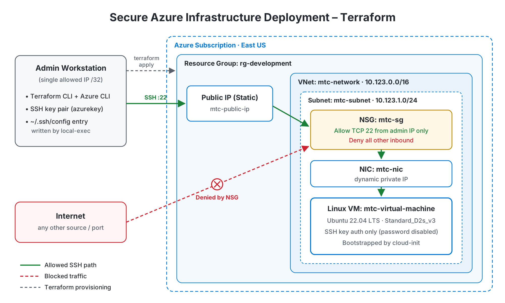

# Secure Azure Infrastructure Deployment with Terraform



## Platforms and Languages Leveraged
- Microsoft Azure (Resource Groups, Virtual Networks, Network Security Groups, Public IPs, Linux VMs)
- Terraform (HashiCorp Configuration Language)
- AzureRM Provider 4.x
- Ubuntu Server 22.04 LTS
- cloud-init (VM bootstrapping)
- Azure CLI
- Bash / OpenSSH
- Git / GitHub

## Scenario

The goal of this project was to replace manual, click-through Azure portal setup with infrastructure that is defined entirely in code, so the same hardened environment can be built, inspected, and torn down on demand. Portal-built environments drift: rules get opened "temporarily," passwords get reused, and nobody can say exactly what was deployed. Defining everything in Terraform makes the environment repeatable and reviewable, and it puts every security decision in version control where it can be audited.

The first working build was intentionally simple and insecure: an NSG rule allowing all inbound traffic from any source, a password-enabled admin account, and a subscription ID hardcoded in the provider block. The second half of the project hardened that baseline without changing what the environment does, then validated each control with real connection tests.

### High-Level Build Plan

- **Provision** the network foundation in Terraform: resource group, VNet, subnet, NSG, and static public IP.
- **Deploy** an Ubuntu 22.04 VM attached through a NIC, bootstrapped at first boot with cloud-init.
- **Harden** the build: default-deny NSG with SSH open only to a single admin IP, key-only authentication, and no secrets in source control.
- **Automate** local access by writing an SSH config entry for the new VM during `terraform apply`.
- **Validate** that allowed traffic works, blocked traffic fails, and the whole environment tears down cleanly.

---

## Steps Taken

### 1. Defined the Network Foundation

Created a resource group (`rg-development`) in East US, a VNet (`10.123.0.0/16`), and a subnet (`10.123.1.0/24`). Attached a Network Security Group to the subnet so every resource inside it inherits the same inbound rules.

### 2. Deployed the Linux VM

Provisioned a static public IP and a NIC with a dynamic private IP, then deployed an Ubuntu 22.04 LTS VM (`Standard_D2s_v3`). The VM is bootstrapped at first boot from `customdata.tpl` through cloud-init, so every deployment comes up configured the same way without manual setup.

### 3. Hardened the Network Perimeter

Replaced the initial allow-all inbound rule with a rule permitting only TCP 22 from a single admin IP. Everything else falls through to Azure's default deny, shrinking the exposed surface from every port to one port from one address.

```hcl
resource "azurerm_network_security_rule" "mtc-dev-rule" {
  name                       = "allow-ssh-from-admin-ip"
  priority                   = 100
  direction                  = "Inbound"
  access                     = "Allow"
  protocol                   = "Tcp"
  source_port_range          = "*"
  destination_port_range     = "22"
  source_address_prefix      = var.allowed_source_ip
  destination_address_prefix = "*"
  # ...
}
```

### 4. Enforced Key-Based Authentication

Removed the hardcoded admin password and disabled password authentication entirely. The VM accepts only the SSH public key passed in through a variable.

```hcl
  disable_password_authentication = true

  admin_ssh_key {
    username   = var.admin_username
    public_key = file(var.ssh_public_key_path)
  }
```

### 5. Removed Secrets From Source Control

Moved the subscription ID and admin IP into variables (the subscription ID is marked `sensitive`). Real values live in a local `terraform.tfvars`, which is excluded by `.gitignore` along with state files, since Terraform state stores resource attributes in plain text. A placeholder `example.tfvars` shows the expected format.

### 6. Automated Local Access

Added a `local-exec` provisioner that runs `mac-ssh-script.tpl` after the VM is created, writing an entry to the local SSH config with the VM's new public IP. The VM's name and public IP are also printed as a Terraform output.

### 7. Validated the Controls

Ran the full lifecycle and tested each control directly rather than assuming the code worked as written.

**`terraform plan`: resources to be created**


**`terraform apply`: deployment complete, public IP output**


**Resource group in the Azure portal**


**NSG inbound rules: SSH from admin IP only**


**Successful key-based SSH login**


**Blocked access: password login rejected / connection from another network times out**


**`terraform destroy`: clean teardown**


---

## Security Controls

| Control | Before | After | Validation |
|---|---|---|---|
| Inbound access | All ports, any source | TCP 22 from one admin IP only | Connection from another network times out |
| Authentication | Password enabled, stored in code | SSH key only, password disabled | Password login rejected |
| Secrets | Subscription ID and password hardcoded | Variables + gitignored `tfvars` and state | No secrets in repo or commit history |
| Configuration drift | Manual setup after deploy | cloud-init at first boot | Identical result on every rebuild |

---

## Timeline of Build Events

1. **Network Provisioned**: Resource group, VNet, subnet, NSG, and public IP defined and deployed in Terraform.
2. **VM Deployed**: Ubuntu 22.04 VM attached through a NIC and bootstrapped with cloud-init.
3. **Perimeter Hardened**: Allow-all NSG rule replaced with SSH-only access from a single admin IP.
4. **Authentication Hardened**: Hardcoded password removed; key-only SSH enforced.
5. **Secrets Removed**: Subscription ID and IP moved to variables; `tfvars` and state excluded from Git.
6. **Access Automated**: `local-exec` provisioner writes the SSH config entry on apply.
7. **Controls Validated**: Allowed and blocked access tested; environment destroyed cleanly.

---

## Usage

```bash
az login
cp example.tfvars terraform.tfvars   # fill in your values
terraform init
terraform plan
terraform apply
terraform destroy                    # tear down when finished
```

**Requirements:** Terraform 1.x, Azure CLI logged in to a subscription, and an SSH key pair at `~/.ssh/azurekey` / `~/.ssh/azurekey.pub` (or override the path variables).

---

## Summary

This project defines a hardened Azure Linux environment entirely in Terraform: networking, access controls, compute, and bootstrapping, deployable or removable with a single command. The initial build was deliberately permissive, and the hardening pass closed the three most common cloud misconfigurations found in real environments: overly open network rules, password-based remote access, and credentials committed to source control. Each control was then validated with direct connection tests rather than taken on faith from the code.

---

## Lessons Learned

- **Security belongs in the code, not the portal.** Because the NSG rule is a reviewed line of Terraform, opening it back up would show up in a diff instead of disappearing into a portal change nobody tracks.
- **Terraform state is sensitive.** State stores resource attributes in plain text, including any password passed to a resource, so removing secrets from `.tf` files isn't enough on its own. State has to stay out of Git too.
- **Commit history outlives fixes.** A secret removed in a later commit is still recoverable from earlier ones, which is why credentials need to be rotated, not just deleted.
- **Test the deny path.** Confirming that SSH works only proves half the control. The blocked attempts are what show the NSG actually restricts access.

---

## Next Steps

- Add a GitHub Actions pipeline that runs `terraform fmt`, `terraform validate`, and Checkov on every push, failing the build on high-severity misconfigurations.
- Move Terraform state to an Azure Storage remote backend with locking.
- Replace the public IP and direct SSH with Azure Bastion for keyless-from-the-internet access.
- Authenticate the pipeline to Azure through GitHub OIDC instead of stored credentials.
